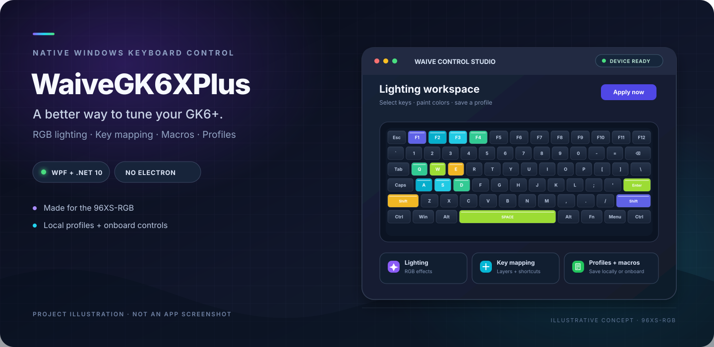

<div align="center">
  

  <br />

  <a href="https://github.com/caioklein/WaiveGK6XPlus"></a>
  
  
  

  <h3>Take control of your keyboard.</h3>
  <p>A native Windows configuration tool for the 96XS-RGB (model 656801936) — lighting, key mapping, macros, and profiles in one focused app.</p>

  <p><a href="#getting-started">Get started</a> · <a href="#features">Features</a> · <a href="#onboard-storage-notes">Storage notes</a></p>
</div>

---

## What is WaiveGK6XPlus?

**WaiveGK6XPlus** is a native Windows keyboard configuration app built as an alternative to the original GK6+ / GK6Plus software for the confirmed **96XS-RGB, model 656801936** running firmware **4.5**.

The app uses **WPF and .NET 10** instead of Electron, Chromium, or a browser-based UI. It combines visual RGB editing with key remapping, macro tools, local profiles, and keyboard onboard storage.

> **Preview note:** The banner above is an original project illustration, not a capture of the running application. The public repository does not currently include real UI screenshots, so none are presented as screenshots here.

## Features

- **🎨 Visual RGB editor** — select individual keys or paint across a group, then tune colors with a color square, hue strip, swatches, or hex values.
- **🌈 Lighting effects** — Solid, Rainbow, Breathing, and Key-press Glow presets, plus imported/custom effects and per-group rules.
- **⌨️ Key mapping** — remap keys and Fn layers, configure modifier shortcuts, media keys, and disabled keys.
- **🎙️ Macro tools** — record and edit macros, then configure repeat, hold, and toggle playback behavior.
- **💾 Local profiles** — save editable `.waive` profile bundles beside the app, with backup copies for earlier saves.
- **🔁 Legacy import/export** — support for native `.waive` bundles and legacy CMF, CMS, simple LE, and GPR files.
- **🖥️ System-tray operation** — minimize to the tray and keep app-controlled lighting running; reopen from the tray icon when needed.
- **🪶 Native Windows app** — WPF UI with no Electron or browser process in the published app folder.

## Compatibility

| Item | Details |
|---|---|
| Keyboard | 96XS-RGB, model `656801936` |
| Firmware | `4.5` is the confirmed target documented by the project |
| OS | Windows |
| UI / framework | WPF on .NET 10 Windows Desktop runtime |
| Profile format | `.waive` (plus supported legacy import/export formats) |

Other keyboard models and firmware versions have not been established as supported. Connect only the target keyboard and close other keyboard-configuration utilities before use.

## Getting started

### 1. Get the source

```powershell
git clone https://github.com/caioklein/WaiveGK6XPlus.git
cd WaiveGK6XPlus
```

### 2. Build and run

Install the **.NET 10 SDK** and the **.NET 10 Windows Desktop runtime**, then run the build script from the repository root:

```powershell
powershell -ExecutionPolicy Bypass -File native/Build.ps1
```

The script restores and builds the native app, runs the protocol/regression checks, and publishes the app to `dist/WaiveGK6XPlus`.

Launch it with either:

```powershell
.\Launch.cmd
```

or:

```powershell
.\dist\WaiveGK6XPlus\WaiveGK6XPlus.exe
```

Keep the published app folder together when moving or updating it. Keep `dist/WaiveGK6XPlus/Profiles` if you want to preserve locally saved profiles.

> **No installer or GitHub Release is currently listed.** These instructions build the application from source.

## Everyday workflow

### Lighting

1. Drag across the keyboard preview to select keys. **Ctrl + drag** adds/removes keys, **Alt + drag** removes keys, and **Shift + click** selects a range.
2. Choose a color or lighting preset and adjust the selected keys.
3. Choose **Apply now** for live app-controlled lighting, or save lighting to a keyboard memory slot when you want it stored onboard.

### Key mapping and macros

Use the key-mapping view to configure ordinary/Fn mappings, shortcuts, and macro assignments. **Save full profile onboard** writes key assignments and referenced macros when the profile includes key/Fn overrides. Review those assignments before writing.

### Profiles and background behavior

- **Save on PC** keeps an editable local profile under `dist/WaiveGK6XPlus/Profiles`.
- Native profile bundles use the `.waive` extension. Import/export also supports CMF, CMS, simple LE, and GPR files.
- The standard Windows minimize button hides the app in the system tray. Double-click the tray icon to reopen it; right-click for **Open**, **Use onboard settings**, and **Exit**.
- **Apply now** requires the app to keep running (minimized to the tray is fine). **Use onboard settings** stops app control and returns to the selected keyboard memory slot.

## Onboard storage notes

Lighting-only and full-profile writes are intentionally separate:

| Action | What it writes | What it preserves |
|---|---|---|
| **Save lighting onboard** | Lighting colors/effects for the selected slot | Existing key assignments and macros |
| **Save full profile onboard** | Lighting, plus key/Fn assignments and referenced macros when overrides are present | Only regions not included in that profile write |

**Important:** onboard flash writes are not documented as transactional. Full flash readback and rollback are not established, and a power-cycle persistence test remains outstanding. A local profile backup is **not** a backup of the keyboard's flash contents. Review what will be written before using the full-profile action.

## Current limitations

- Confirmed target hardware is the 96XS-RGB (model `656801936`) with firmware `4.5`; other combinations are unverified.
- Grouped/music/game effects, OLED or mouse configuration, and firmware updating are outside the current release.
- Key-press glow requires **Apply now** or an editable keyboard Layer 1, 2, or 3; built-in lighting slots are for lighting only and cannot remap keys.
- Power-cycle persistence after onboard writes has not yet been independently confirmed.

## Build and verification

The app and checks are maintained under `native/`. Build from the repository root with:

```powershell
powershell -ExecutionPolicy Bypass -File native/Build.ps1
```

This runs the C# protocol/regression checks before publishing. For implementation details and the complete feature notes, see [`native/README.md`](native/README.md).

## Repository layout

```text
.
├── docs/                 # Design notes and cleanup report
├── native/               # WPF application, device/protocol code, checks, build script
├── reference/            # Protocol fixtures, CLI reference, archived diagnostic evidence
├── Launch.cmd            # Launch the published app
├── Launch-Native.cmd     # Compatibility shortcut
└── README.md
```

## Contributing

Bug reports, reproducible device traces, and focused pull requests are welcome. When reporting a hardware issue, include the keyboard model, firmware version, the action taken, and whether it was a live apply, lighting-only onboard save, or full-profile onboard save. Avoid posting reports that expose personal paths or device identifiers.

## License

No project-wide `LICENSE` file is currently present at the repository root. Check the licensing terms for the relevant source files before redistributing the project or modified binaries.

---

<div align="center">
  <sub>Built for the 96XS-RGB. Designed to keep keyboard customization native.</sub>
</div>
